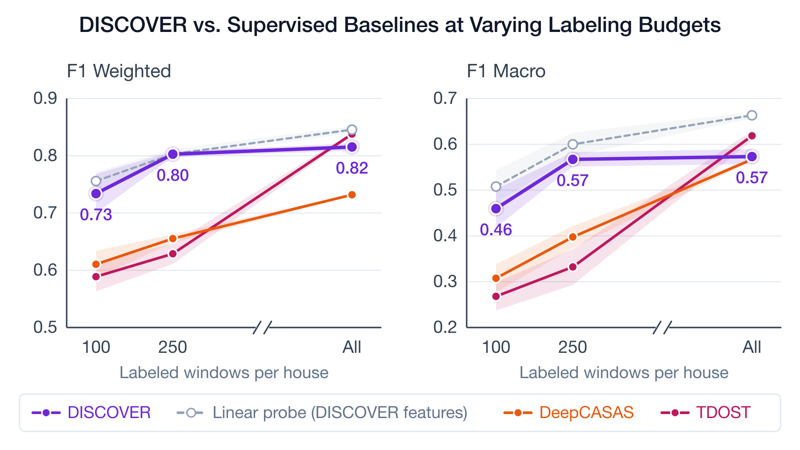
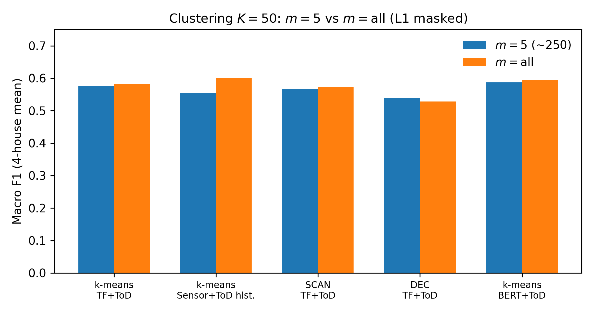
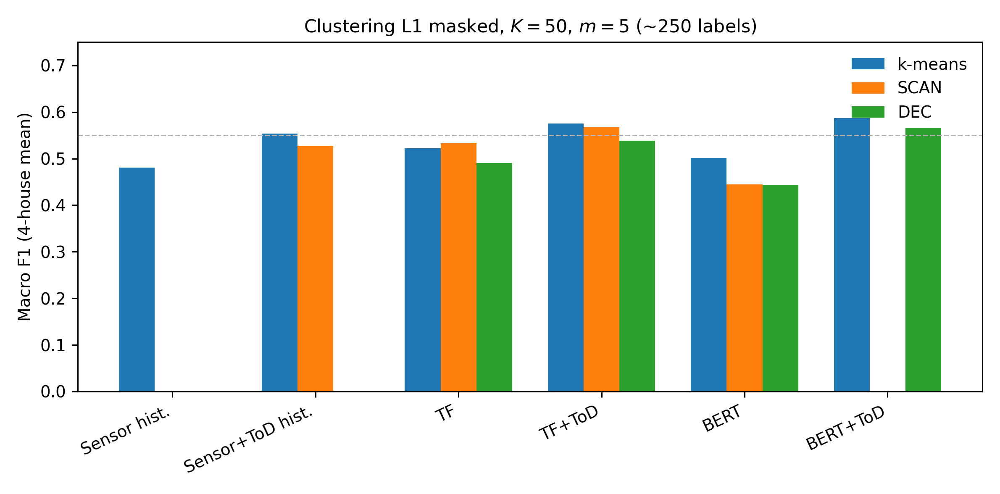
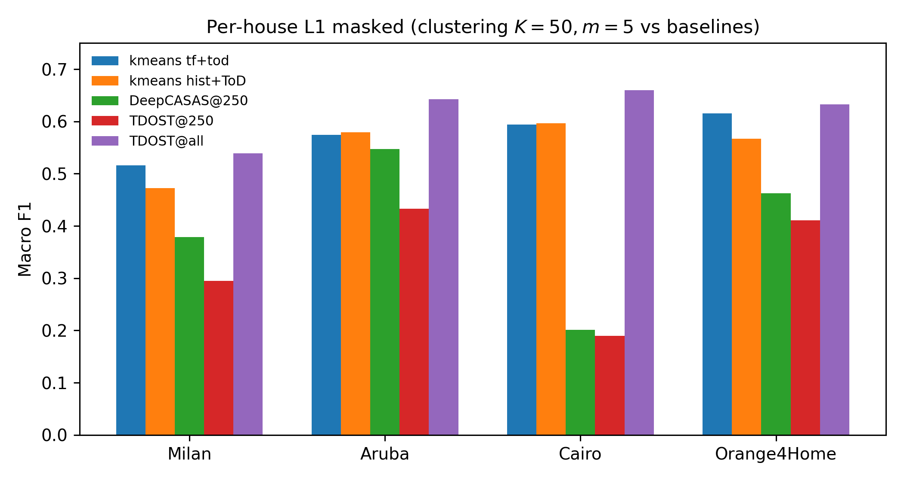
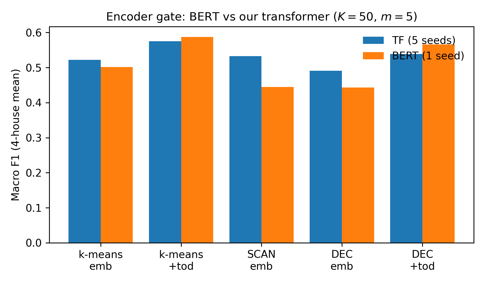

# DISCOVER revision — final seeded runs (2026-11-13)

Continuous FL_20 train/val; FL_20_p test only. No coordinates. No_Activity never predicted on test.
Activity-only label budgets. Cells in tables: **mean over seeds** of weighted / macro F1.

**Artifacts:** `tables/*.md|tex`, `figures/*.pdf|png`, `confusion/`, `report.pdf`, scored CSVs in `data/`.

| Coverage | |
|---|---|
| Clustering setups scored | 34 (method × rep × K) |
| Baseline setups | 9 (method × budget) |
| TF encoder seeds | 5 houses×seeds complete |
| BERT encoder seeds | 1 (gate) |
| DeepCASAS / TDOST npz | 5 seeds × L1/L2 × 100/250/all |

## Headline numbers (L1 masked, 3-house avg, W/M)

| Setup | Labels | W / M |
|---|---|---|
| k-means **TF+ToD**, $K=50$, $m=5$ | ~250 | **0.81 / 0.56** |
| k-means Sensor+ToD hist., $K=50$, $m=5$ | ~250 | 0.80 / 0.55 |
| k-means BERT+ToD, $K=50$, $m=5$ (1 seed) | ~250 | 0.82 / 0.57 |
| DeepCASAS | 250 | 0.66 / 0.40 |
| TDOST | 250 | 0.63 / 0.33 |
| k-means TF+ToD, $K=50$, **$m=$all** | all pool labels | 0.82 / 0.57 |
| k-means Sensor+ToD hist., $K=50$, $m=$all | all pool labels | 0.82 / 0.59 |
| TDOST | all | **0.84 / 0.62** |
| DeepCASAS | all | 0.73 / 0.57 |







Interpretation, decisions and next steps: `tist_revision/FINDINGS.md` (curated) and
`tist_revision/EXPLORATIONS.md` (log). This file only holds generated numbers.





## Tables
- [`tables/clustering_m5.md`](tables/clustering_m5.md) / `.tex` — Clustering, $m=5$
- [`tables/clustering_m1.md`](tables/clustering_m1.md) / `.tex` — Clustering, $m=1$
- [`tables/clustering_mall.md`](tables/clustering_mall.md) / `.tex` — Clustering, $m=all$
- [`tables/baselines.md`](tables/baselines.md) / `.tex` — Supervised baselines (DeepCASAS, TDOST)
- [`tables/probes.md`](tables/probes.md) / `.tex` — Linear probes on frozen representations
- [`tables/matched_budgets.md`](tables/matched_budgets.md) / `.tex` — Clustering vs supervised at matched label budgets
- [`confusion/confusion_matrices.pdf`](confusion/confusion_matrices.pdf) — per-house confusion matrices and
  per-class F1 for TDOST, k-means hist / TF+ToD and the TF+ToD probe (`python -m tist_revision.pipeline.confusion`)

## Caveats
- Means over seeds; day-block bootstrap CIs not in these tables (run `final_scores --n_boot 50` for CIs).
- BERT is a single seed; TF and most baselines are 5 seeds.
- Preliminary if any baseline npz is still landing on skynet.

## Regenerate
```bash
python -m tist_revision.pipeline.report_final --rescore --pdf --probes
```
